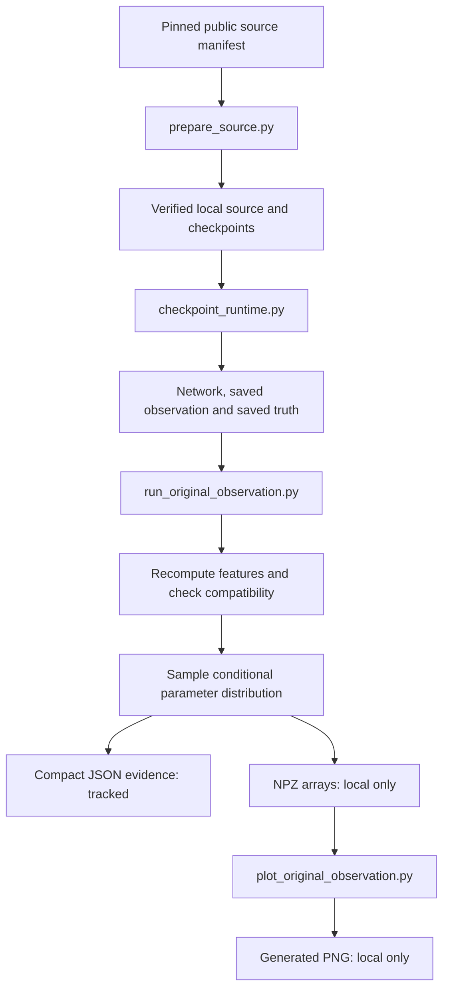

# Reading the thesis codebase

This guide explains the code currently on this Mac. It uses our implementation, the authors' public source, and the verified checkpoint metadata. It does not reproduce the private benchmarking paper or its extracts.

Our working program is a checkpoint-compatibility and saved-example inference harness. It loads pretrained Random Walk networks, checks the input features, samples parameter distributions, and records results. We have not yet run the original simulator, retrained a network, or reproduced aggregate paper metrics.

An important unresolved issue is prior provenance. Our harness imposes a uniform box support reconstructed from the `.voc` bounds. The authors' `run_training()` entry point constructs a Gaussian prior; another upstream experiment path uses a box prior. Matching the limits does not establish that our posterior wrapper matches the training and inference conditions that produced the saved networks.

## 1. The scientific problem behind the code

Write the unknown parameter vector as `theta` and the observed time series as `x`.

A forward simulator takes parameters and random inputs and generates observations. Inference works in the other direction: given observations, which parameter values are plausible?

Bayesian inference expresses that question as:

`p(theta | x) proportional to p(x | theta) * p(theta)`

Neural posterior estimation, or NPE, learns an approximation `q_phi(theta | x)` from simulated parameter/data pairs. The trained object describes a distribution over parameters. It is more than a regression predicting one best parameter vector.

The intended training pattern is:

1. Draw parameters under the chosen training prior.
2. Run the simulator to obtain a dataset.
3. Prepare the observations and features.
4. Train a conditional density estimator on parameter/data pairs.
5. Reuse that estimator for inference on observations compatible with the training setup.

Training is expensive because it requires simulated datasets and optimization. Sampling an already trained network can be fast. Our current code performs the last step using an observation already stored in the checkpoint.

For Random Walk, the four inferred quantities are:

| Name | Intended role | Bounds read from the author `.voc` file |
| --- | --- | --- |
| `Drift` | Systematic movement under the model's parameterization | -1 to 1 |
| `InitS` | Initial state | 0 to 10 |
| `NoiseStd` | Process-noise scale | 0 to 0.5 |
| `MeasStd` | Measurement-noise scale | 0 to 0.5 |

These names and bounds do not certify the compiled simulator's exact equations, discretization or noise implementation. That still needs source/runtime validation.

## 2. Three parts of the workspace

```text
Research Project/
  AGENTS.md                      Standing workflow and privacy instructions
  README.md                      Current research status and entry points
  baseline-reproduction/         Our runnable checkpoint harness and explanations
  experimental-design/           Proposed later misspecification study and planner
  execution/                     Dated progress and constraints
  reproduction.nosync/           Ignored runtime, upstream assets and generated arrays
  verification/                  Local earlier source-verification evidence
  reproduction/                  Local historical material from the earlier setup
```

`baseline-reproduction` is the current execution work. `experimental-design` describes the later research study. Their sample-size numbers serve different purposes and should not be mixed.

There are also two code owners to distinguish:

- **Our code:** source verification, CPU loading adapter, saved-example runner, reporting, plotting and VS Code tasks.
- **Authors' code:** embedding-network definitions, handcrafted features, Vensim integration, training and aggregate validation routines. Copies are under `reproduction.nosync/upstream/`; original local verification copies also exist. We preserve the authors' files rather than editing them in place.

## 3. How one run moves through the files



The diagram shows the recommended sequence of operations; there is no single command that automatically executes every box. Source preparation, inference and plotting are separate commands/tasks. The current inference command does not call the Vensim simulator or the authors' training functions.

## 4. Pinning and preparing the source

Read [prepare_source.py](prepare_source.py) alongside [source-manifest.json](source-manifest.json).

The manifest records the public repository revision, expected Git blob hashes, file sizes, and SHA-256 hashes where available. The pinned revision is `d74a866f0476c07e93d786d297f90c0706281c33`.

`prepare_source.py` selects common source files and the assets for `RW`, `SEIRb`, or `GB`. It first looks for an existing local copy. If online mode is allowed and an asset is absent, it downloads from the pinned public revision. It verifies the bytes before accepting them.

Git hashes a file with a header containing its type and byte count. Consequently, the helper checks:

```python
hashlib.sha1(b'blob ' + str(len(data)).encode() + b'\0' + data)
```

This is different from computing SHA-1 on the file contents alone. A mismatch stops preparation. The script does not silently accept a changed model because its filename looks right.

The verified files go into `reproduction.nosync/upstream/`. The compact receipt goes into [source-checks.json](source-checks.json). The receipt describes the most recently selected model; it is not a cumulative claim that every model in the manifest is installed.

`--offline` prohibits downloads and reports missing assets. Our RW preparation verified 19 files. Hash verification establishes agreement with the pinned manifest, not scientific correctness or complete training provenance.

## 5. Loading a checkpoint on this Mac

Read [checkpoint_runtime.py](checkpoint_runtime.py).

`load_checkpoint(model, budget)` forms the filename, verifies the checkpoint plus the original custom-class and package-initialization files, and makes the upstream package importable. Pickle needs the original `setup_functions.classes.SequenceNetwork` name to reconstruct the serialized object.

The saved tensors reference CUDA storage. `CPUUnpickler` intercepts PyTorch's storage-loading function and supplies `map_location='cpu'`. It then moves the restored module to CPU and calls `.eval()`.

`.eval()` selects inference behavior for modules such as dropout and batch normalization. It does not retrain the network or replace its learned weights.

The loader locates the embedding module's saved `vensimInputs` dictionary. That dictionary contains the original observation `x_o`, the saved true parameters, feature settings and model metadata. Only its runtime device setting is changed to CPU.

The adapter uses legacy pickle loading, including `weights_only=False` for tensor-storage reconstruction. This is not a general-purpose sandbox for arbitrary checkpoints: only the fixed, verified author artifacts should be loaded.

The same file's `prior_bounds()` reads the numerical limits and their ordering from the selected `.voc` file. It returns names, lower bounds and upper bounds. Reading limits is not the same thing as discovering the original prior distribution. Also, `prior_bounds()` does not independently hash the `.voc` file on every invocation; source preparation is where that file is hash-checked.

## 6. What the network actually receives

The saved RW input has shape:

```text
(1, 151, 1)
 ^   ^   ^
 |   |   one observed series
 |   100 observed values followed by 51 handcrafted features
 one dataset in this call
```

The last 51 entries are not additional observation times. The loaded estimator first applies its serialized `Standardize` module, then `SequenceNetwork.forward()` separates the standardized time series and handcrafted features. The standardizer preserves the shape and uses statistics already stored in the checkpoint; we do not fit a new scaler to the saved example.

A tensor is an array with shape, data type and device information. Here the observed input is used as a CPU float32 tensor. A saved truth vector contains four parameter values; the runner preserves its saved numerical precision.

The current program draws 10,000 joint parameter vectors, producing shape `(10000, 4)`. Each row is one plausible combination of all four parameters. Four separate marginal histograms show only parts of that joint distribution; they do not show its parameter correlations.

## 7. The authors' handcrafted features

Read the public [pre_experiment.py](https://github.com/ali-akhavan89/SD_Neural_Estimation_Benchmarking/blob/d74a866f0476c07e93d786d297f90c0706281c33/setup_functions/pre_experiment.py), particularly `generate_summary_statistics()`.

For the inspected RW checkpoint, the settings are a smoothing window of 20, polynomial order 2, 20 interior summary points, two moments, and residual-correlation lags 0, 5 and 10.

The 51 features consist of:

| Group | Count |
| --- | ---: |
| Mean smoothed absolute residual and series mean | 2 |
| Mean and standard deviation requested by `num_moments=2` | 2 |
| Normalized fitted-series values at 22 selected indices | 22 |
| Normalized smoothed absolute-residual values at those indices | 22 |
| Residual correlations at three lags | 3 |
| Total | 51 |

The function smooths the time series using a Savitzky–Golay filter, computes residuals, smooths their absolute magnitudes, and builds the feature vector. The actual implementation includes the series mean twice. We retain that behavior because changing feature order or definitions would change the meaning of a trained network's input.

Our runner recomputes these features from the first 100 saved values and compares them with the last 51 saved entries. The observed maximum absolute difference was about `5.722e-6`. The acceptance test uses `torch.allclose` with both absolute and relative tolerances of `1e-5`; it is not a rule that every possible run must have absolute error below `1e-5` regardless of scale.

## 8. The learned embedding and density estimator

Read the public [classes.py](https://github.com/ali-akhavan89/SD_Neural_Estimation_Benchmarking/blob/d74a866f0476c07e93d786d297f90c0706281c33/setup_functions/classes.py). The following dimensions were inspected in the loaded 100k RW checkpoint, rather than inferred from constructor defaults.

```text
Saved input                       (1, 151, 1)
Stored Standardize module          (1, 151, 1)
  Time-series branch              (1, 100, 1)
  Reorder for Conv1D               (1, 1, 100)
  Four MultiConv1D blocks          (1, 96, 100)
  Reorder for LSTM                 (1, 100, 96)
  Bidirectional LSTM outputs       (1, 100, 256)
  Select final output timestep     (1, 256)

  Handcrafted-feature branch       (1, 51, 1)
  Flatten                         (1, 51)

Concatenate the branches           (1, 307)
Linear layer plus ReLU             (1, 16)
Conditional flow                  Distribution over 4 parameters
```

Each `MultiConv1D` block has three parallel convolutions with kernel widths 1, 2 and 3. Each produces 32 channels; concatenation gives 96 channels. The block crops outputs to a common sequence length. Four blocks therefore contain twelve Conv1D modules, not four individual convolutions. The source does not insert an extra ReLU between these convolution blocks.

The LSTM has 128 hidden units per direction. Its bidirectional output has 256 components at each time position. The source selects the final output timestep; it does not replace this with a different pooling or final-hidden-state scheme.

The 256 selected LSTM components and 51 handcrafted features form a 307-component vector. A linear layer and ReLU produce 16 learned summary components. Those 16 values condition the posterior estimator; they are not 16 inferred physical parameters. The learned compression is not guaranteed to preserve every inferential detail merely because it has 16 components; its performance still needs validation.

The inspected density estimator is an `NFlowsFlow`, containing an affine transform and six masked affine autoregressive transforms with permutations. A normalizing flow transforms a simple random distribution into a flexible distribution over the four parameters, conditioned on the observation embedding. Its transformations support density evaluation and sampling while preserving dependencies between parameters.

The loaded observation wrapper is `Sequential(Standardize, SequenceNetwork)`. The manual feature formula has its own normalization, and this stored standardization is an additional step. Preserve both. The flow also retains its serialized affine transformation in parameter space, so returned samples are interpreted in the original parameter coordinates.

The serialized checkpoint contains the learned weights. Constructing a fresh `SequenceNetwork()` from the class defaults would create a new network with random weights and potentially different dimensions.

## 9. The main runner, step by step

Read [run_original_observation.py](run_original_observation.py).

**Arguments and resources.** The runner accepts `--draws` and `--seed`. Defaults are 10,000 and 42. Numerical thread settings are limited to two and plotting is headless. Increasing draws improves Monte Carlo resolution for this same observation; it does not create more independent datasets or increase the network's training budget.

**Prior/support construction.** It reads RW bounds and constructs `BoxUniform`. It also hash-checks the upstream preprocessing source. The loader separately verifies checkpoint/class files.

**Checkpoint loop.** It loads `1k`, `10k` and `100k`. These labels refer to the training-budget variants of the saved networks. This loop does not train on 1,000, 10,000 or 100,000 new datasets.

**Compatibility checks.** It compares parameter ordering and numerical limits between the `.voc` file and saved configuration. Order matters: interpreting the first sample column as `InitS` rather than `Drift` could produce plausible-looking but invalid results.

**Observation checks.** It extracts `x_o` and `true_parameter`, checks their shapes/finiteness where implemented, and recomputes the handcrafted features. It requires all three checkpoints to contain the same saved observation and truth. This comparison uses exact equality across the recovered tensors.

**Seed control.** Some upstream modules reset random seeds when imported. Our runner resets PyTorch and NumPy seeds again after imports so the requested sampling seed is honored.

**Sampling.** `DirectPosterior` wraps the restored density estimator. In installed sbi 0.23.3, this sampler proposes conditional draws from that estimator and rejects proposals outside the supplied prior's support. Our code requests 10,000 accepted four-dimensional draws for each checkpoint.

**Output checks.** It checks sample shape, finiteness and compliance with the configured VOC support. Passing these guards establishes technical properties of the returned arrays, not statistical calibration.

**Summaries.** For each parameter, it computes a posterior mean, median, and equal-tailed 95% interval using the 2.5th and 97.5th percentiles. The saved truth allows an interval-inclusion flag for this example. A single such flag is not an estimate of 95% coverage.

**Timing.** The recorded interval begins before constructing `DirectPosterior` and ends after sampling. It excludes environment installation, imports, checkpoint loading, feature recomputation, plotting and file writing. It should not be compared directly with a paper's full workflow runtime.

## 10. The unresolved prior distinction

This needs attention before extending the compatibility check into a published-baseline replication.

Our wrapper currently produces the learned density restricted to a rectangle:

`q_box(theta | x) proportional to q_phi(theta | x) * indicator(theta inside VOC bounds)`

`DirectPosterior.sample()` does not multiply the learned density by a new Gaussian or uniform probability density. The supplied prior is used here to decide whether proposed parameters are in support. A Gaussian has unbounded support; a bounded uniform rejects points outside its rectangle. Those choices can yield different samples. Supplying a box prior to this wrapper does not by itself convert a Gaussian-trained posterior into a uniform-prior posterior. It restricts the learned distribution; a scientifically valid prior conversion would need its own justified method and known training provenance.

In the pinned public `run_training.py`, `run_training()` constructs a multivariate Gaussian with midpoint means and standard deviations equal to one quarter of the corresponding bound widths. The simulator wrapper clips parameters to its limits. `generate_true_parameters()` draws validation truths uniformly between the bounds. The alternative `run_experiments.py` / `run_analysis.py` path uses `BoxUniform` and handles returned simulation parameters differently.

Consequently:

- The same `.voc` limits can be used with different prior distributions.
- A saved network plus its model-configuration dictionary does not establish its complete training lineage.
- A successful bounded-support rerun should not be described as verified equivalence to the authors' Gaussian-prior inference path.
- We must audit clipping, requested versus actually simulated parameters, validation draws and checkpoint provenance before certifying a baseline.

No numerical outputs were changed while documenting this distinction. Our completed run remains useful evidence that the pinned networks and preprocessing work on the native Mac runtime.

## 11. Files produced and how to interpret them

| File | Content | GitHub policy |
| --- | --- | --- |
| `original-observation-summary.json` | Versions, seed, source revision, checks, timings and parameter summaries | Tracked compact evidence |
| `source-checks.json` | Verified artifact identities for the selected preparation run | Tracked |
| `reproduction.nosync/results/original-observation/posterior-samples.npz` | All generated samples, saved input and saved truth | Local only |
| `reproduction.nosync/results/original-observation/posterior-comparison.png` | Our generated marginal posterior comparison | Local only |
| Runtime/install logs | Package/setup and run details | Local only |
| Benchmarking paper, appendix, ZIP and extracted manuscript text | Private reference material | Never push |

`plot_original_observation.py` reads the current local arrays and compact summary. It draws four marginal histograms, overlays the three checkpoint budgets, and adds saved-truth reference lines. It does not load or copy a paper figure.

The current scripts overwrite these fixed output locations on a successful rerun. A failed attempt can leave an earlier successful summary in place, so check the process exit status, log and `created_utc` timestamp before treating a file as evidence of the latest attempt. The JSON records a SHA-256 hash of the local NPZ, but the plotting script does not automatically enforce that pairing. Archive or label run artifacts before a new scientific comparison; a full experiment/run manager is not implemented yet.

## 12. Configuration and environment files

| File | Actual role |
| --- | --- |
| `baseline-config.json` | Human-readable starting plan; the current runner does **not** read this file |
| `target-register.csv` | Progress/target checklist; it does not launch or validate experiments |
| `source-manifest.json` | Machine-readable expected identities of public upstream files |
| `requirements.in` | Direct dependency choices used to bootstrap the environment |
| `environment-lock.txt` | Exact installed package versions for restoring this native environment |
| `Thesis.code-workspace` | VS Code folder, interpreter setting and manual tasks |
| `REPRODUCTION_PLAN.md` | Scientific sequence and gates before paper-level claims |

`AGENTS.md` contains instructions for the assistant and the research workflow; Python does not execute that Markdown file. None of these scripts automatically commits or uploads files to GitHub. A run can modify the local tracked JSON summary, but publication requires the separate reviewed Git commit/push step.

`prepare_source.py` and `run_original_observation.py` have a `main()` guarded by `if __name__ == "__main__"`, so importing their helper functions does not execute the complete command. The inspector and plotting script currently execute their command bodies at the top level and are intended to be run as scripts.

Changing `baseline-config.json` alone will not change the actual draw count, seed or model loop. The implemented controls are the runner's command-line arguments and code. The runner is currently RW-only; the asset preparer and inspector understand SEIRb and GB names, which does not mean their complete pipelines have been run.

The general `python3` installation and the thesis environment are separate. Use the interpreter under `reproduction.nosync/.venv` so the tested package versions are used.

## 13. The authors' larger pipeline

The public notebook calls `run_training()` from `setup_functions/run_training.py`. It can load existing estimators or train new ones, then request validation calculations. Our lightweight harness deliberately avoids calling that full entry point because it also reaches the simulator and platform-specific dependencies.

| Upstream file | What to read it for |
| --- | --- |
| `Main.ipynb` | Scenario settings and the main notebook entry point |
| `run_training.py` | Network construction, prior construction, checkpoint loading/training and validation orchestration |
| `run_experiments.py` | Alternative batch experiment/configuration path |
| `run_analysis.py` | Alternative training path and fresh validation-data generation helper |
| `vensim_simulation_model.py` | Parameter adjustment, Vensim input files, engine calls, extraction and feature concatenation |
| `pre_experiment.py` | VOC parsing, Vensim support-file preparation and manual statistics |
| `classes.py` | MultiConv1D and SequenceNetwork definitions |
| `validation_calculations.py` | Implementations of aggregate metrics and SBC-related routines |
| `plots.py` | The authors' reporting/plotting helpers |

The Vensim wrapper writes sensitivity-control inputs, runs the engine and extracts outputs ordered using simulation seeds. It can adjust parameters before simulation and returns the adjusted parameters. Which parameter values become the training labels differs across the source paths and needs an explicit audit.

Metric names alone are insufficient to establish equivalence. The active code currently does the following:

- `calculate_rmse()` takes posterior means, computes RMSE across validation cases per parameter, divides by the supplied prior standard deviations, and averages across parameters.
- `calculate_agg_post_cont()` averages `1 - posterior_variance / prior_variance`, using sample posterior variance with `ddof=1`.
- `calculate_agg_int_score()` combines interval width and penalties for missing the truth, then normalizes and averages.
- `calculate_coverage_prob()` pools interval inclusion across cases and parameters, computes absolute deviation from each nominal level, assigns error 1 when pooled coverage is exactly zero, and averages the errors across levels. Smaller is better for this active implementation.

The coverage function's docstring describes a different ratio score with perfect value 1. That is not what its executable body currently returns. Read the active implementation rather than relying on the name or docstring. Also, pooled coverage can conceal differences between individual parameters.

Inside `run_training()`, some normalization quantities use a uniform-box variance formula while the RMSE normalizer is estimated from clipped Gaussian prior draws. These choices and parameter subsets need to be matched to the actual reference target; we have not certified them as the paper's exact definitions. Our saved-example runner does not execute these aggregate metric functions.

## 14. Where the later thesis experiment fits

`experimental-design/` contains the proposed misspecification protocol, review log, readable overview and study-planning arithmetic. It is a separate future stage.

`planning.py` accepts pilot success and discordance counts, forms conservative planning bounds and returns an allocation subject to a 1,000–3,000-ID cap. With no pilot counts it prints hypothetical examples. It does not simulate Random Walk, run NPE, execute a pilot or reproduce a benchmark table.

Our current runner makes no stock, flow or noise-mechanism changes. The prior/support issue above is a baseline-alignment question, separate from the planned model-misspecification treatments.

The intended sequence is: verify assets and checkpoint compatibility; establish the original simulator/prior/validation conditions; reproduce matched-model results; then compare controlled model departures with an appropriately fixed estimator.

## 15. A practical reading order

1. Read this guide and `REPRODUCTION_PLAN.md` to understand the scope and remaining gates.
2. Open `original-observation-summary.json` to see what the program actually produced.
3. Read `run_original_observation.py` from top to bottom, following each imported helper.
4. Read `checkpoint_runtime.py` and `prepare_source.py` for loading and provenance.
5. Read the authors' `classes.py` and `generate_summary_statistics()` while following the tensor-shape diagram.
6. Read `DirectPosterior.sample()` in the installed sbi source for proposal/rejection behavior.
7. Trace the authors' `Main.ipynb` → `run_training()` path and compare its prior and clipping logic with our wrapper.
8. Read aggregate metric implementations and the later experimental design after those distinctions are clear.

From the project root, the basic commands are:

```sh
reproduction.nosync/.venv/bin/python baseline-reproduction/prepare_source.py --model RW --offline
reproduction.nosync/.venv/bin/python baseline-reproduction/inspect_checkpoint.py --model RW --budget 100k
reproduction.nosync/.venv/bin/python baseline-reproduction/run_original_observation.py --draws 10000 --seed 42
reproduction.nosync/.venv/bin/python baseline-reproduction/plot_original_observation.py
```

VS Code also exposes these operations through **Terminal → Run Task**. They are manual tasks; nothing automatically runs when the folder opens. The Python editor-extension download encountered a Marketplace DNS failure, but these process-based tasks and the tested command-line interpreter work without that extension.
